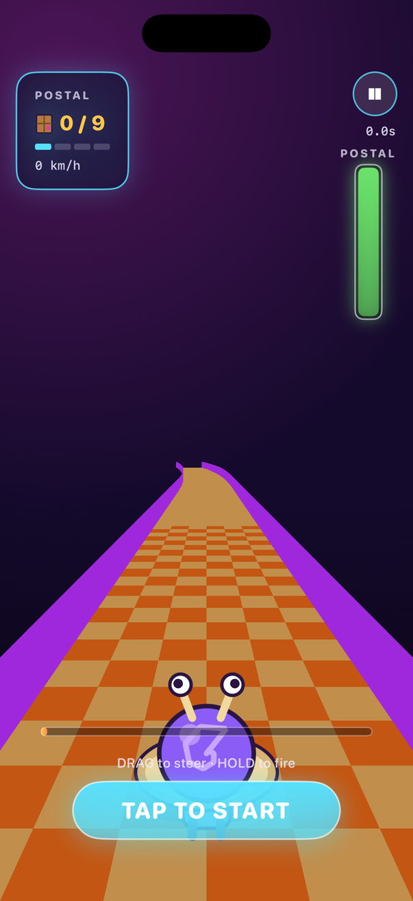
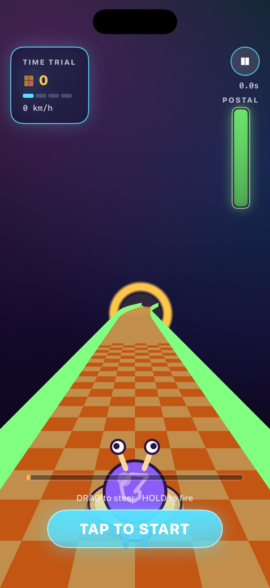

# Snail Mail (蜗牛竞速) — iOS Portrait Remake

An independent SwiftUI + SpriteKit remake of **蜗牛竞速 / Snail Mail**, the 2005
Reflexive arcade racer where a turbo-charged snail blasts along an intergalactic
highway delivering mail past salt crystals, blue meteorites and slugs.

Everything on screen is drawn from code. The road, the snail, the pickups, the
space backdrop and the whole UI are procedural sprites and SwiftUI shapes, so
the project ships **no art extracted from the retail game**. The remake is
built for a portrait phone: the pseudo-3D road, the vertical postal meter and
the mode menu are all laid out for one hand.

## Screenshots

| Menu | Gameplay | Challenge | Time Trial |
| --- | --- | --- | --- |
|  |  |  |  |

## Gameplay

- Steer the snail horizontally by dragging anywhere on the screen.
- The highway scrolls toward you. Dodge **salt grains**, **blue meteorites**,
  **slugs** and **gaps in the road** to keep the postal meter alive.
- Weapons auto-fire while you hold; shooting hazards clears them for score.
- Pickups:
  - **Parcel** — counts toward the delivery quota
  - **Heart** — repairs the postal meter
  - **Ring** — upgrades the weapon tier toward rockets (green), detonates
    nearby hazards (gold) or slows you (violet)

## Modes

- **Postal** — the delivery campaign loop; meet the parcel quota before the
  route ends.
- **Challenge** — a long, densely seeded survival highway.
- **Time Trial** — reach the post office at the end of the route.

## Art direction

One shared palette and drawing style runs through the menu, HUD, results and
the in-game sky: a flat cartoon-neon look with bold dark outlines, saturated
fills, a deep-space purple gradient, a ringed planet and drifting stars. The
menu backdrop and the in-game sky are generated from the same code
(`UI/Theme.swift` for SwiftUI, `Game/Sprites.swift` for SpriteKit), and the menu
mascot is drawn from the same coordinates as the racer itself, so the whole
game reads as a single product.

## Requirements

- Xcode 26+ / iOS 17+ deployment target
- **Portrait** iPhone or iPad (locked to `UIInterfaceOrientationPortrait`)

## Build & Run

```bash
open SnailMail.xcodeproj
# or from the command line:
xcodebuild -project SnailMail.xcodeproj -scheme SnailMail \
  -sdk iphonesimulator -destination 'generic/platform=iOS Simulator' build
```

## Project Layout

```
SnailMail/
  Sources/
    App/    App entry point + root view
    Game/   GameModel, GameScene (loop/spawn/collisions), Sprites (procedural art)
    UI/     Menu, HUD, Game wrapper, result overlay, Theme (shared art kit)
  Assets.xcassets
docs/
  screenshots/
```

## Status

Playable portrait remake with the original's three modes. Next steps:
per-planet level progression, richer enemy behaviour, sound, and saved high
scores.

---
Snail Mail is a trademark of its respective owners. This is an independent,
non-commercial fan remake with original code and original procedural art.
