# Snail Mail (蜗牛竞速) — iOS Portrait Remake

An independent SwiftUI + SpriteKit remake of **蜗牛竞速 / Snail Mail**, the 2005
Reflexive arcade racer where a turbo-charged snail blasts along an intergalactic
highway delivering mail past salt crystals, blue meteorites and slugs.

Everything on screen is drawn from code: the road, the snail, the pickups, the
space backdrop and the whole UI are procedural sprites and SwiftUI shapes, so a
fresh checkout ships **no art extracted from the retail game**. The remake is
built for a portrait phone: the pseudo-3D road, the vertical postal meter and
the mode menu are all laid out for one hand.

`SnailMail.dat` stores its scripts behind a byte-wise XOR with a 256-byte
repeating key, and once peeled back it is a plain 601-entry archive. The
campaign's balance data comes from it: per-level speed, hazard probabilities,
parcel counts, route length, backdrop and fringe colour for the arcade levels,
plus the tutorial and challenge tuning. Those numbers (and the level/galaxy
names that go with them) are what the campaign screen and `LevelConfig` use.

The archive also holds the 2005 build's own **artwork and audio** — its
textures, sprites, sky backdrops, music, effects and the snail's spoken lines.
`tools/import_art.py` decodes those into `SnailMail/Resources/Retail`, which is
gitignored, and when that folder is present the game draws the retail art and
plays the retail soundtrack instead of the procedural stand-ins. Run it once
against your own copy of the installer to get the pixel-level look; a clone
that skips it still builds and runs on the procedural art. See
[Retail assets](#retail-assets).

The same scripts carry the words the original prints around a race: each level's
`GalaxyText:` briefing (Turbo's log entry, or an "IPS WARNING" notice about the
gaps and ramps ahead) and the opening-crawl and credits text, all of which the
remake shows on its own screens.

With the retail folder in place the app plays the original music, effects and
voice-over; without it, `AVAudioEngine` synthesises a looping chiptune and the
effect cues at runtime. The shipped repository contains no images or sounds.

## Screenshots

| Menu | Tutorial | Time Trial | Challenge |
| --- | --- | --- | --- |
| 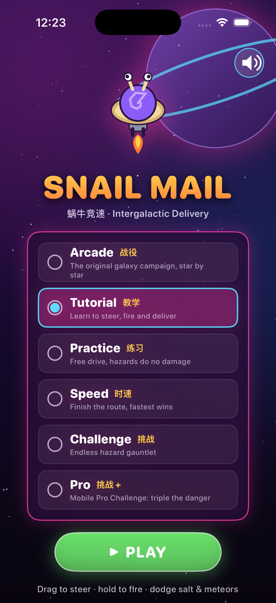 | 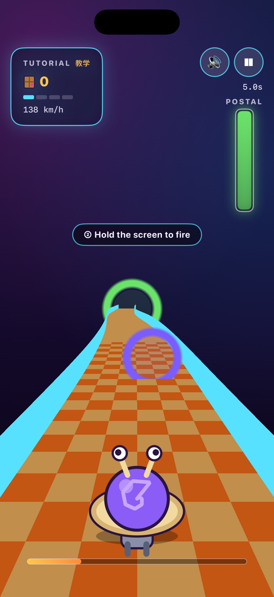 | 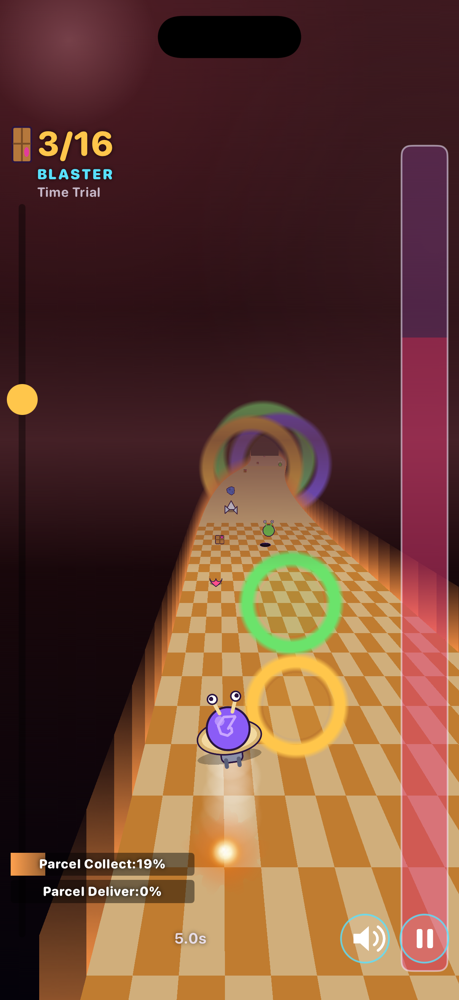 | 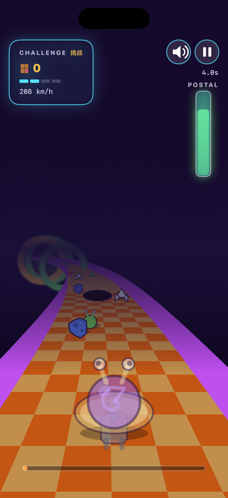 |

| Galaxy map | Briefing | Results |
| --- | --- | --- |
| 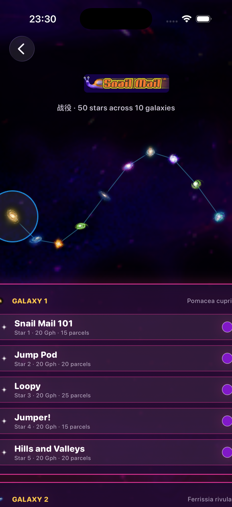 | 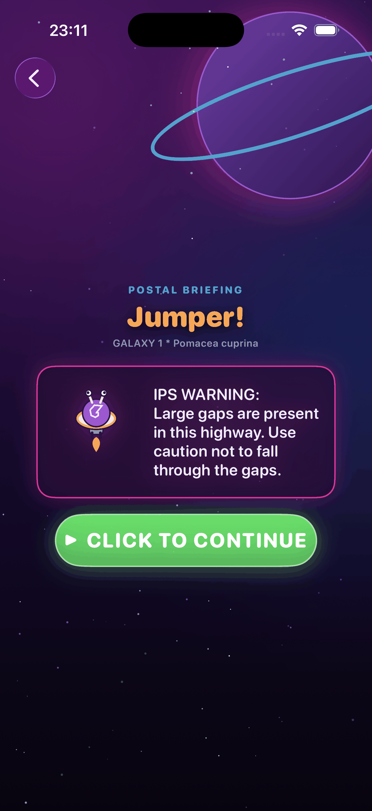 | 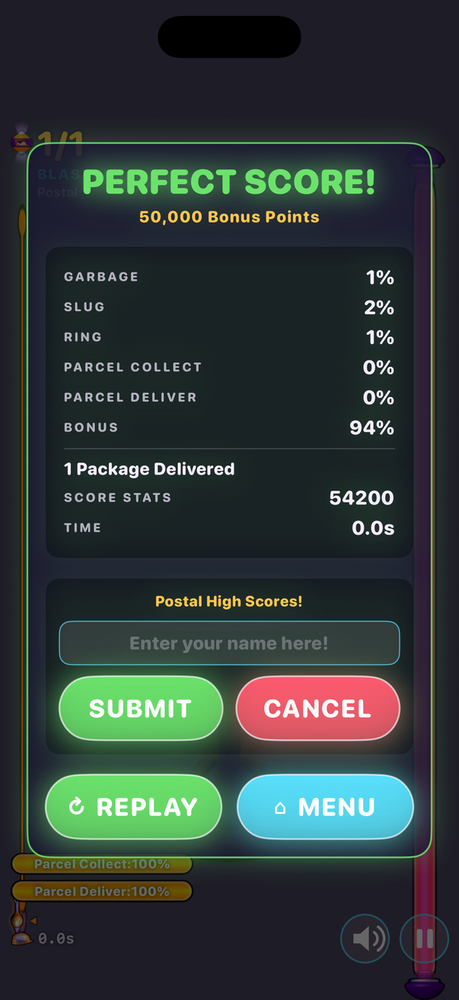 |

| Help | Options | High Scores |
| --- | --- | --- |
| 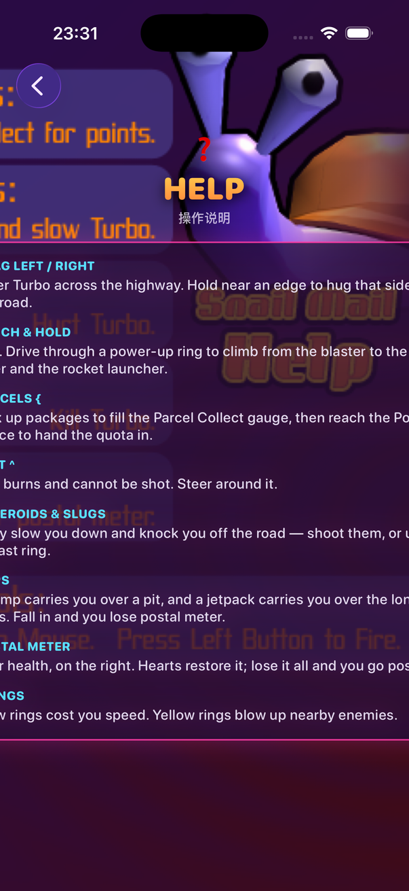 | 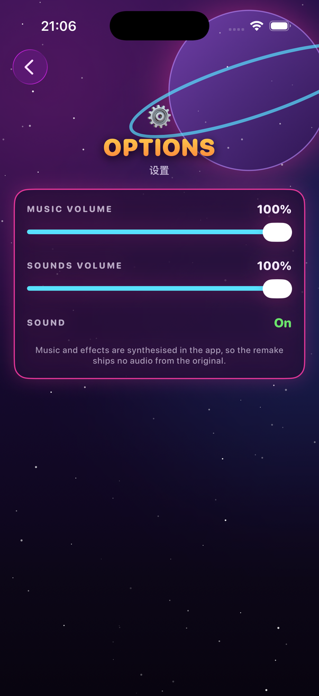 | 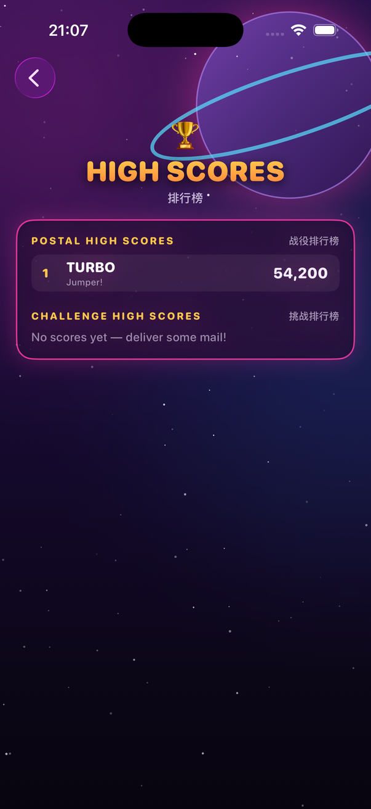 |

| Intro | Credits |
| --- | --- |
| 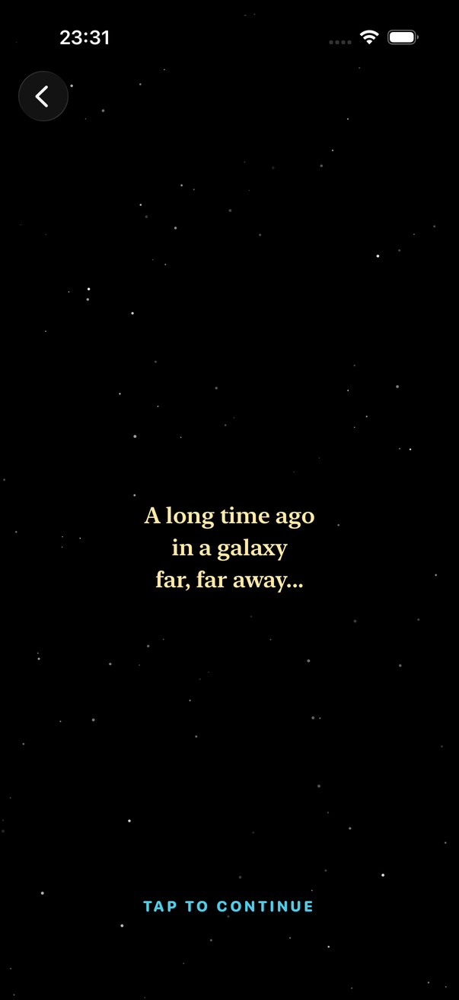 | 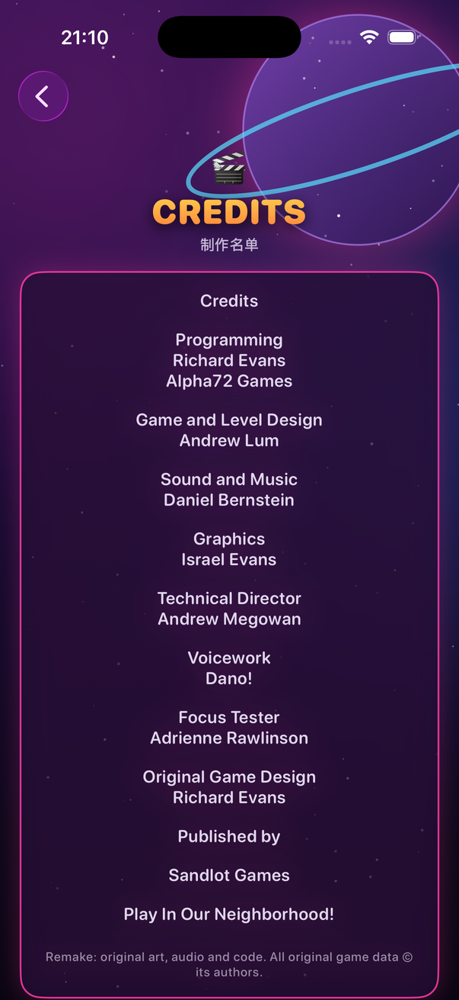 |

The app opens on the 2005 build's loading screen — its SNAIL MAIL lockup over
the title backdrop, with a gold bar filling underneath. A tap skips it.

| Loading |
| --- |
| 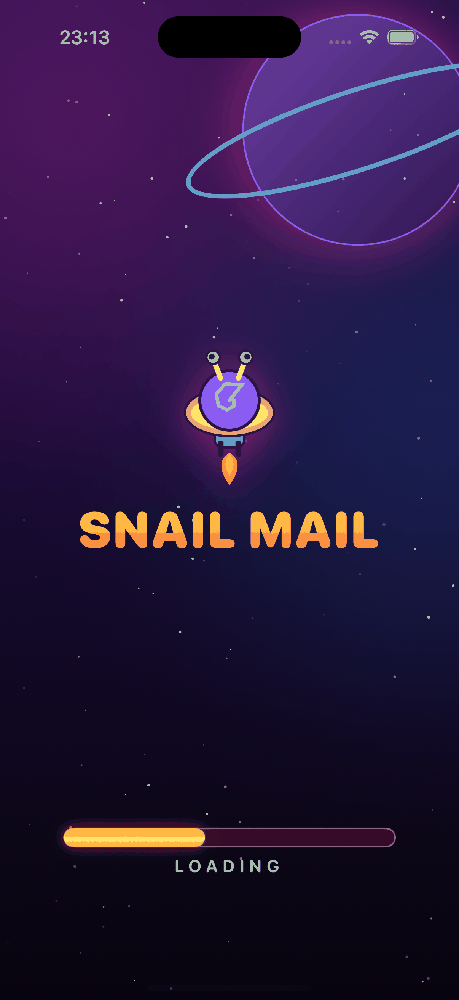 |

## Gameplay

- Steer the snail horizontally by dragging anywhere on the screen.
- The highway scrolls toward you. Dodge **salt grains**, **blue meteorites**,
  **slugs** and **gaps in the road** to keep the postal meter alive.
- Weapons auto-fire while you hold; shooting hazards clears them for score.
- Pickups:
  - **Parcel** — counts toward the delivery quota
  - **Heart** — repairs the postal meter
  - **Power-up ring** — the only way up the weapon ladder, which runs nine
    rungs from the starting blaster to the rocket launcher and turns the snail
    invulnerable on its top two. Every ring climbs a rung and pays 100 into the
    Parcel Collect tally (green)
  - **Blast ring** — detonates nearby hazards (gold)
  - **Slow ring** — drags the snail down (violet)

## Modes

The 2005 PC build shipped four modes, and this remake keeps exactly those:

- **教学 Tutorial** — guided, damage-free. On-screen prompts walk through
  steering, firing, collecting parcels, grabbing upgrade rings and delivering
  to the post office.
- **战役 Postal** — the original campaign (its level files are the
  `Arcade*.txt` set): ten galaxies of five stars each,
  played from a galaxy map. Every star uses its own tuning from the retail data
  file, so the early teaching levels are gentle and "40 Gph" through "100 Gph"
  ramp the speed, salt, garbage and slug density right up.
- **时速 Time Trial** — a shorter route at high speed; reach the post office
  and the clock is the score.
- **挑战 Challenge** — a long, densely seeded survival highway. The retail
  level file marks it `Random:yes`, so its 51-piece pool is drawn as a shuffled
  deck and laid out differently every run.

The later mobile port's *Practice* and *Pro Challenge* are not part of this
build, so they are left out.

### Around a race

Picking a star on the galaxy map shows that level's **briefing** first — the
`GalaxyText:` paragraph the retail build prints before a route, "CLICK TO
CONTINUE" and away. The menu also carries the original's side screens: **Help**,
**Options** (music and sound-effect levels), **High Scores** (the Postal and
Challenge tables, with the original's "Enter your name here!" prompt when a run
makes the board), the **Intro** crawl and the **Credits**. Postal runs are tuned
by the start screen's **Select Speed** and **Select Difficulty** rows, which
scale each level's own numbers.

## Track data

The campaign, tutorial and challenge courses are the retail game's own tracks
rather than invented ones. `SnailMail.dat` ships everything XOR-obfuscated with
a 256-byte key; undoing that exposes a plain archive of level scripts
(`LEVELS/*.txt`), track pieces (`SEGMENTS/*.txt`) and artwork. Each level file
lists a pool of segments and a row budget, and each segment is a stack of
eight-cell rows where a cell is road, wall, off-road or a hazard — salt,
meteors, slugs, turrets, pits, rings and parcels. `tools/import_tracks.py`
converts those scripts into `Game/TrackData.swift`, and `TrackBuilder` plays
them back: the same segment order, the same length, and every hazard in the
lane the original put it in. Bends come from the piece's `Path=` family and
the drift of the drivable band across its rows, with the slow drift removed so
a long bend never walks the road off the screen.

`tools/import_tracks.py` reads only this configuration data; the artwork and
audio in the same archive are handled separately by `tools/import_art.py`.

## Retail assets

The 2005 installer's archive mixes level scripts with the game's own content:
`*.TGA` textures and sprites, ASCII DirectX `.x` models (the `X/*.x2` blobs)
and Ogg Vorbis music, effects and voice-over. `tools/import_art.py` pulls those
out and writes the two formats iOS reads natively — TGA to PNG and Ogg to AAC
(`.m4a`) through `afconvert` — into `SnailMail/Resources/Retail`. That folder is
deliberately untracked: it is the retail build's content, so it stays on the
machine that owns a copy of the game.

```bash
python3 tools/import_art.py path/to/蜗牛竞速.zip      # or path/to/SnailMail.dat
```

A build phase copies `SnailMail/Resources/Retail` into the app bundle when it
exists, so a clean checkout still builds and simply falls back. `RetailAssets`
is the single switch: every lookup returns `nil` when the folder is absent and
the procedural drawing takes over. It covers the road surfaces, the sky, the
snail and its damage/invincible skins, the weapon tiers, the pickups and
hazards, the UI backdrops and the star map.

`tools/bake_meshes.py` (normally run by the importer) rasterises the `.x` meshes
— the snail, salt shakers, turret pillars, roadside signs, the post office —
from the chase camera's angle into flat, toon-shaded PNG billboards under
`Art/Baked`, which is how SpriteKit shows them. `tools/make_app_icon.py` builds
the app icon from the same palette.

## Art direction

One shared palette and drawing style runs through the menu, HUD, results and
the in-game sky: a flat cartoon-neon look with bold dark outlines, saturated
fills, a deep-space purple gradient, a ringed planet and drifting stars. The
menu backdrop and the in-game sky are generated from the same code
(`UI/Theme.swift` for SwiftUI, `Game/Sprites.swift` for SpriteKit), and the menu
mascot is drawn from the same coordinates as the racer itself. When the retail
folder is installed those procedural drawings are replaced by the originals —
the desert / grass / ice / nebula road surfaces, the sun-baked snail skins, the
sky backdrops and the HUD chrome — so the same code reads either way.

## Audio

`Game/Sound.swift` plays the retail music, effects and voice-over when the
imported assets are present, and otherwise synthesises everything with
`AVAudioEngine` into in-memory PCM buffers: a looping four-bar chiptune plus
`shoot`, `collect`, `upgrade`, `hit`, `boost`, `select`, `win` and `lose` cues.
The snail's spoken lines are the retail recordings, played through a pooled bus
with the original's volume table (`_VOICE.TXT`) and a limiter so the chatter
never overlaps or cuts itself off; the tutorial speaks each scripted prompt as
the track reaches it. It fails silently if audio is unavailable, and the menu
and HUD both expose a mute toggle.

## Requirements

- Xcode 26+ / iOS 17+ deployment target
- **Portrait** iPhone or iPad (locked to `UIInterfaceOrientationPortrait`)

## Build & Run

```bash
open SnailMail.xcodeproj
# or from the command line:
xcodebuild -project SnailMail.xcodeproj -scheme SnailMail \
  -sdk iphonesimulator -destination 'generic/platform=iOS Simulator' build
```

## Project Layout

```
SnailMail/
  Sources/
    App/    App entry point + root view
    Game/   GameModel, GameScene (loop/spawn/collisions), TrackData (retail
            scripts), LevelCatalog, Sound, Sprites + RetailAssets (art)
    UI/     Menu, HUD, Game wrapper, result overlay, Theme (shared art kit)
  Assets.xcassets
  Resources/Retail/   (untracked; written by tools/import_art.py)
tools/
  import_tracks.py   regenerate Game/TrackData.swift from SnailMail.dat
  import_art.py      decode the retail textures, models and audio
  bake_meshes.py     rasterise the .x meshes to billboards
  make_app_icon.py   build the app icon
docs/
  screenshots/
```

## Status

Playable portrait remake of the retail four modes — Tutorial, Postal (the
ten-galaxy / 50-star campaign), Time Trial and Challenge — with procedural art,
procedural audio and a guided tutorial that speaks the retail voice-over.
Around a race it keeps the original's side screens: the per-level `GalaxyText:`
briefing before each star, Help, Options, saved Postal and Challenge high-score
boards (with the "Enter your name here!" prompt) and the intro crawl and
credits. A perfect run pays the original's 50,000-point bonus. Run
`tools/import_art.py` to swap the procedural art and audio for the retail
originals.

---
Snail Mail is a trademark of its respective owners. This is an independent,
non-commercial fan remake with original code and original procedural art.
