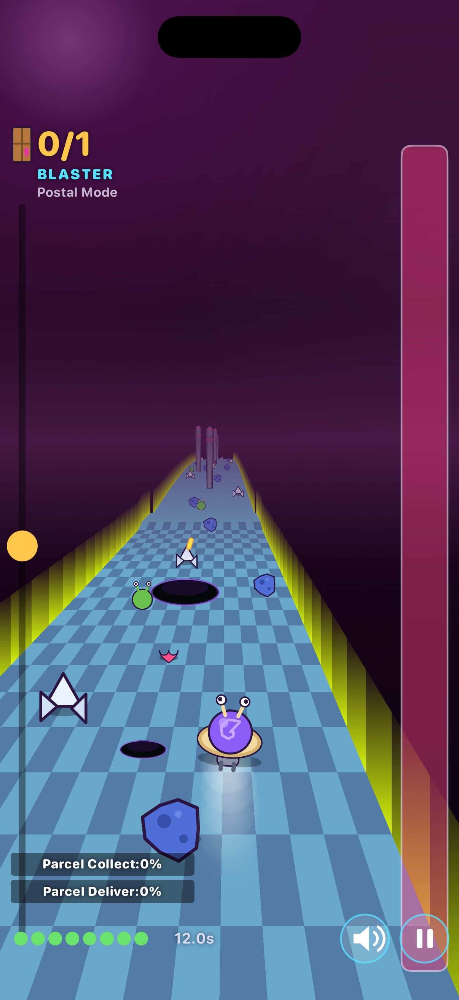

# 自动试玩记录：重制版

这份报告采用方案 2：让重制版沿真实赛道自动驾驶，逐帧记录车道、附近路面对象、碰撞、掉坑和摄像机投影，再以静止截图核对画面中的车辆位置。它验证的是重制版实际执行的移动与碰撞代码。

## 当前结果

| 关卡 | 完成时间 | 结束时血量 | 掉坑 | 包裹 | 结局 |
|---|---:|---:|---:|---:|---|
| 1 | 25.63 秒 | 100/100 | 0 | 15 | **胜利** |
| 37 | 39.44 秒 | 60/100 | 0 | 19 | **胜利** |
| 38 | 33.23 秒 | 30/100 | 0 | 19 | **胜利** |
| 39 | 39.33 秒 | 92/100 | 0 | 33 | **胜利** |
| 47 | 25.69 秒 | 96/100 | 0 | 24 | **胜利** |
| 49（100 Gph!） | 36.31 秒 | 86/100 | 0 | 16 | **胜利** |

以上六局使用 `seed 4242`，全部到达终点、0 次掉坑，包裹都超过该关配额，结果页判定为胜利。扣血来自擦到盐、陨石和围栏，随后被路上的心形补给补回一部分；38 关是压力最大的一局，完成时只剩 30/100 血。49 关以最高速度跑完，用于覆盖移动与碰撞判定更快的情况。

这一轮解决了两个影响收集和避坑判断的碰撞问题：

- **包裹收不到。** 碰撞用 `Sprites.snailModelWidth`（0.606 模型单位）算车宽，而原版 `TURBOHOTSPOTS` 记录的碰撞盒是 1.469 单位——画出来的 Turbo 宽 0.16 路面，1.469 单位也正好是 0.163 路面，两者一致。旧值只有画面的 0.067 路面，于是车体擦着路面中央的包裹过去也不会捡起。改用 1.469 之后包裹可以收取。
- **避坑判断与碰撞判断不一致。** `isWalkable` 把坑宽按 `fraction / 2` 折算成模型单位，而碰撞按 `fraction` 折算，规划器因此会选中车尾悬在坑沿上的车道。修正后 37 关重新回到 0 掉坑。

包裹能捡到之后，之前的每局 `GONE POSTAL` 变成了真正的胜利结算：`-autopilot-collect` 让自动驾驶在避开障碍的前提下绕路去取包裹，表中各关的包裹数都超过配额。

可复核的紧凑轨迹和检查输出在 [`traces/`](traces/)：

| 关卡 | 逐帧轨迹 | 检查报告 |
|---|---|---|
| 1 | [`level01.jsonl`](traces/level01.jsonl) | [`level01.report.txt`](traces/level01.report.txt) |
| 37 | [`level37.jsonl`](traces/level37.jsonl) | [`level37.report.txt`](traces/level37.report.txt) |
| 38 | [`level38.jsonl`](traces/level38.jsonl) | [`level38.report.txt`](traces/level38.report.txt) |
| 39 | [`level39.jsonl`](traces/level39.jsonl) | [`level39.report.txt`](traces/level39.report.txt) |
| 47 | [`level47.jsonl`](traces/level47.jsonl) | [`level47.report.txt`](traces/level47.report.txt) |
| 49 | [`level49.jsonl`](traces/level49.jsonl) | [`level49.report.txt`](traces/level49.report.txt) |

轨迹按行保存每帧状态，碰撞、掉坑和终点另有事件行。`nearby` 只保留当前车道附近有内容的路面对象，避免把远处装饰误算成碰撞。

## 修复前后对照

- 37 关原来会卡在坑前连续回退，记录到 26 次掉坑、血量 4/100；修复后 0 掉坑并拿到 19 个包裹。修复前的记录保留在 [`traces/level37-ramp2.jsonl`](traces/level37-ramp2.jsonl)。
- 38 关原为 1 次掉坑、66/100 血；现在 0 掉坑、19 个包裹、完成时 30/100 血、判定胜利。
- 39 关早先出现过重复掉坑和整排围栏碰撞，现在 0 掉坑、33 个包裹、完成时 92/100 血、判定胜利。
- 1 关先前每局都以 `GONE POSTAL` 结束（包裹 0），现在包裹 15、满血、判定胜利。

碰撞盒变宽后，扣血次数比旧记录上升：车体确实会碰到路边的盐和围栏。自动路线在盐密的关卡（38 关 `Sodium Squared`）依旧会撞得多，人工驾驶也需要尽量避免贴边。

## 画面识别与同帧校准

车辆识别按紫色壳体和车身空间形状排除右侧细长 HUD 与紫色特效，取下方宽而扁的车辆区域中心；程序化外壳与原版贴图两种外壳都覆盖。道路读取则使用同帧引擎投影，截图与引擎记录按动画帧配对。

39 关固定帧 710：



引擎记录车道位置 `x=0.400`，识别车辆中心在 `x≈0.498`；使用同帧道路中心和半宽换算后得到 `0.132`，差值为 **0.268 个路面单位**。分析图缩到 240×426，每个路面单位约 38 像素，因此约为 10 像素。工具以 0.30 作为可复核的误差阈值，并输出原值与误差。

1 关固定帧 710 的复测为 `x=−0.800`、识别换算 `−0.875`，差值 **0.075**，约 3 像素。截图不叠加暂停遮罩；截图时模拟器收到一次暂停键盘事件，会真正停下场景，以便截取和引擎相同的画面。

[`level39-vision.jsonl`](traces/level39-vision.jsonl) 是 39 关逐帧状态；同帧摄像机记录和识别结果分别是
[`level39-vision.camera.jsonl`](traces/level39-vision.camera.jsonl) 与
[`level39-vision.vision.jsonl`](traces/level39-vision.vision.jsonl)。对照报告见
[`level39-vision.report.txt`](traces/level39-vision.report.txt)。1 关对应截图在
[`keyframes/level01/`](keyframes/level01/)。

普通道路颜色读取在这几张截图中仍不完整，这不是一条可以直接声称已解决的测量链。39 关的截图在 Turbo 中央行（画面高度约 0.77）只看到右侧车道边缘，靠近底部的左右边界又受到 HUD 影响；该行引擎投影的左侧位置本身超出画面，为 `x≈−0.93`。因此当前把“识别车辆”和“同帧校准车辆相对位置”作为已验证部分；完整道路宽度仍未由画面独立求出，不能宣称已从截图完全识别车道。

## 原版对照尚未完成

原版没有成功进入能连续驾驶的关卡。Wine 停在菜单和开场内容；XP 虚拟机未能稳定进入驾驶场景。因此目前**没有**原版与重制版的速度、碰撞时序、掉坑惩罚或摄像机手感定量对照。项目中原版的文本与道路比例检查是另一类静态/画面核对，不能替代真实试玩基准。

碰撞盒这一项尤其需要原版确认：`TURBOHOTSPOTS` 的 1.469 单位来自原版数据文件，本次是按该数值实现，还没有在可驾驶的原版里实测“擦过包裹是否收取”。

后续要做的是解决原版键盘输入，并在相同的路段采集驾驶前后帧；再用上述逐帧状态与截图工具比较。此次报告本身不应被解读为两种版本已经对齐。

## 复跑与检查

在已构建的重制版调试 App 中，用同一随机种子启动自动游玩：

```sh
xcrun simctl launch --console-pty <SIMULATOR_UUID> com.lvyufeng.SnailMail \
  -autostart arcade -level 37 -seed 4242 -autopilot -autopilot-collect \
  -autopilot-runs 1 -autopilot-trace /tmp/level37.jsonl
python3 tools/check_autopilot.py /tmp/level37.jsonl
```

`-autopilot-collect` 让自动驾驶在安全前提下绕路取包裹。不加这个参数时会优先选最接近的直行车道；37 关复跑仍为 0 掉坑，但只收到 2 个包裹，未达配额。

`-autopilot-shot DIR -autopilot-camera-trace FILE` 会在选定帧暂停，保存场景投影。随后用 `xcrun simctl io <SIMULATOR_UUID> screenshot FILE` 截取同一帧，并用
`swift tools/autopilot_vision.swift OUT FILE` 读取画面。

`tools/build_autopilot_corpus.py SOURCE DESTINATION` 从完整原始轨迹生成已提交的紧凑版本，保留结束和碰撞事件。

## 关键帧

39 关围栏与动态摄像机的截图仍保存在 [`keyframes/level39/`](keyframes/level39/)；固定帧识别截图则在
[`keyframes/level39-vision/`](keyframes/level39-vision/)。所有截图保留重制版实际 HUD、道路和车辆，不用编辑后的画面替代运行结果。

## 记录层修正

轨迹里的事件列表原来每帧都写一遍完整累积值，只在换局时清空。同一局的三次受击因此被写成了 10,716 条事件，文件多出约 700 KB，检查工具统计也会失真。现在每帧写入后立即清空：同样一局写出 8 条事件（4 次受击各两类），文件从 3,554 KB 降到 2,794 KB。

`runResult` 字段仍只反映最后一帧的状态快照，结算结果以 `kind: "finish"` 的事件行为准，检查工具读的是后者。
